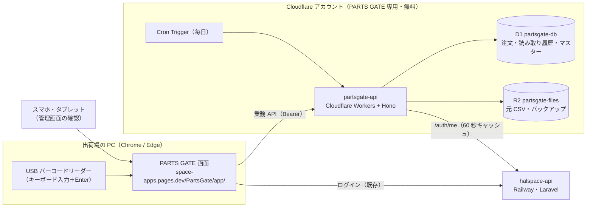

# PARTS GATE 技術構成

- 版: 0.1（STEP 3 設計・ドラフト）／作成日: 2026-11-05
- 前提: [requirements.md](requirements.md)

## 1. 現状調査の結果（2026-11-05）

| 項目 | 調査結果 | 影響 |
| --- | --- | --- |
| 作業フォルダ | `c:\dev\my-programming\PartsGate` は空・Git 管理外 | 新規作成。既存ファイルの上書きなし |
| Git | ルートは `c:\dev\my-programming`（HaLSpace モノレポ）。ブランチ `feat/cloudflare-migration`。他アプリの未コミット変更が多数ある | コミットは `git add PartsGate/...` のようにファイル指定。`git add -A` 禁止 |
| 画面の配信 | Cloudflare Pages `space-apps`（リポジトリ直下を静的配信、**main への push だけが本番**） | `PartsGate/app/` にビルド済みファイルを置けば同じオリジンで配信できる |
| ログイン | halspace-api（Laravel、Railway）。`GET /api/auth/me` が `id / role / company_id / apps_enabled` を返す。トークンは sessionStorage の `space_token` | TENQ と同じ方法で検証する（参考: `TENQ/api/src/middleware/auth.ts`） |
| 前例 | TENQ（Workers＋D1＋R2、無料プラン）が 2026-10-22 から本番稼働 | 部品・手順・注意点を流用する |
| 前例の事故 | 2026-10-22、開発環境の負荷計測で D1 の読み取り上限（アカウント全体で 1 日 500 万行）に達し、本番 TENQ が朝 9 時まで停止 | **PARTS GATE は別の Cloudflare アカウントに置く**。性能テストはローカルで行う |

## 2. 全体構成



役割分担:

- **Space.app（halspace-api）**: この人は誰か・どの会社か・PARTS GATE を使えるか（`apps_enabled` に `partsgate`）。アカウント作成・パスワード・2 段階認証・停止
- **PARTS GATE（partsgate-api＋D1）**: PARTS GATE 内のロール、作業担当者、置場・納品先、注文、読み取り履歴、集計、監査ログ

## 3. 技術スタック

| 層 | 採用 | 理由・注意 |
| --- | --- | --- |
| 画面 | React 19 + TypeScript + Vite | 指示書どおり。TENQ と同じ版にそろえる |
| CSS | Tailwind CSS v4（`@tailwindcss/vite`） | 指示書どおり。ビルド時だけ使う |
| ルーティング | ハッシュ方式（`#/scan` など） | 共有 Pages に SPA のフォールバックがないため |
| API | Cloudflare Workers + Hono | 小さく速い。Next.js・Prisma・zod は入れない（affect_CRM / TimeCalc が Workers から撤退した原因） |
| DB | D1（SQLite）。prepared statement＋`bind()` のみ、ORM なし | マイグレーションは `wrangler d1 migrations` |
| ファイル | R2（バインディング経由・非公開） | 元 CSV とバックアップ |
| CSV の文字コード | ブラウザ標準の `TextDecoder('shift_jis')` | ライブラリ不要 |
| 音 | Web Audio API で正常・警告・異常の音を合成 | 音声ファイル不要 |
| グラフ | 軽量な SVG を自前で描く（棒・折れ線のみ） | 大きなグラフライブラリを入れない |
| テスト | Vitest（`@cloudflare/vitest-plugin` で D1 込みの API テスト）、Playwright（E2E） | 開発専用 |

## 4. 認証・テナント判定の流れ

1. ログイン画面で halspace-api の `/auth/login`（2 段階認証を含む）を呼び、`space_token` を sessionStorage に保存（Space.app 共通）
2. 業務 API は `Authorization: Bearer <space_token>`
3. partsgate-api のミドルウェア（TENQ の `auth.ts` を流用）:
   1. トークンの SHA-256 でキャッシュを引く。なければ `/auth/me`（タイムアウト 5 秒、結果を 60 秒キャッシュ）
   2. 401 → 401。`apps_enabled` に `partsgate` がない → 403
   3. D1 の `users` を `hs_user_id` で引く（なければ作成。Space.app の admin / super_admin で、その会社にまだ PARTS GATE 管理者がいなければ管理者にする）
   4. `users.status = 'suspended'` または `companies.status <> 'active'` → 403
   5. `{ user, companyId, role }` をリクエストに載せる。**company_id は必ずここから取り、画面から送られた値は使わない**
4. 読み取り API はさらに作業セッション（`work_sessions`）を確認する（[scan-matching.md](scan-matching.md) §2）

## 5. フォルダ構成（予定）

```
PartsGate/
├── CLAUDE.md / README.md
├── docs/            設計書
├── package.json     npm workspaces（web, api, shared）
├── web/             画面（React + Vite + Tailwind）。ビルド出力は ../app（base: '/PartsGate/app/'）
├── api/             partsgate-api（Workers + Hono）
│   ├── src/  index.ts / middleware/ / routes/ / domain/ / db/
│   ├── migrations/  0001_init.sql …
│   ├── test/        API 結合テスト・テナント分離テスト
│   └── wrangler.toml  env.dev / env.production
├── shared/          画面と API で共有する型・照合結果・権限表・CSV 定義
├── e2e/             Playwright
├── scripts/         性能テスト用データ生成、バックアップ復元、サイズ確認
└── app/             web のビルド成果物（Pages で配信。Git にコミットする）
```

画面の配信は TENQ と同じく「ビルド成果物 `PartsGate/app/` をコミット」する方式。共有 Pages の設定を変えないので、他アプリに影響しない。**フォルダ名 `PartsGate` は URL になるので、本番公開後は変えない**（Pages は大文字小文字を区別する）。

## 6. 無料プランに収める設計

公式の上限（2026-10 時点。本番前に再確認する）と見込み（ヒラノ 1 社）:

| 項目 | 無料プランの上限 | 見込み | 対策 |
| --- | --- | --- | --- |
| Workers リクエスト | 10 万／日 | 数百〜数千／日 | なし |
| Workers CPU | **1 回 10ms** | 照合 1 回は数 ms | CSV の解析・差分計算・CSV 出力の組み立ては画面側。API は 200 行ずつ受け取る |
| D1 読み取り | **500 万行／日（アカウント全体）** | 普段は数万行 | ①専用アカウント ②集計表（`daily_scan_stats`）でダッシュボードを描く ③検索はすべて索引が効く形にし、部分一致検索は期間指定を必須にする ④性能テストはローカル |
| D1 クエリ数 | 50／回 | 照合 1 回は 3〜5 本 | `db.batch` でまとめる |
| D1 容量 | 500 MB／DB | 年 30〜50 MB（§7） | 照合・検索に使う列だけ保存し、81 列の原本は R2。400 MB を超えたら古い年度を R2 へ移すか有料化を判断 |
| R2 | 10 GB、書き込み 100 万回／月 | 元 CSV 年 20 MB程度＋バックアップ | なし |
| Cron Trigger | アカウントあたり 5 個 | 1 個（毎日のバックアップ） | なし |

上限に達しても請求は来ない（無料プランのまま止まる）。有料プラン（Workers Paid、月 5 ドル）への切り替えはオーナーの承認なしに行わない。

## 7. 容量の見積もり

| 対象 | 1 行の大きさ（索引込み） | 1 年 | 10 年 |
| --- | --- | --- | --- |
| order_items（約 3,000 行／月） | 約 650 バイト | 約 24 MB | 約 240 MB |
| orders（伝票。明細の約 6 割） | 約 200 バイト | 約 5 MB | 約 50 MB |
| scan_logs（明細の 1.3 倍と想定） | 約 350 バイト | 約 17 MB | 約 170 MB |
| 集計表・マスター・監査ログ | — | 数 MB | 数十 MB |
| **合計** | | **約 50 MB** | **約 500 MB** |

10 年目に無料の上限（500 MB）に届く見込み。他社が加わった場合は会社数に比例して増えるので、その時点で有料化（10 GB／DB）を判断する。

## 8. 主な処理の分担（CPU 10ms 対策）

| 処理 | 画面（ブラウザ） | API（Workers） |
| --- | --- | --- |
| CSV 取込 | 文字コード判定・解析・検証・差分計算・プレビュー | 既存明細の照会（キーを 500 件ずつ）、200 行ずつの登録、元ファイルの R2 保存 |
| 照合 | 入力の整形・二重送信防止・表示・音 | 判定と記録（最終判定は必ず API） |
| CSV 出力 | ページごとの JSON を CSV に組み立て | 500 件ずつの JSON |
| ダッシュボード | グラフ描画 | 集計表の読み出し |
| バックアップ | — | 毎日、前回以降に増えた行を R2 へ（NDJSON） |
