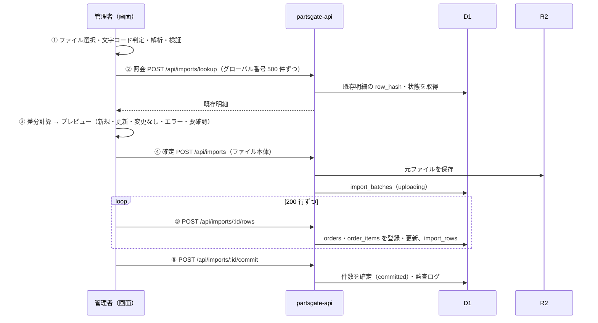

# PARTS GATE CSV 取込仕様

- 版: 0.1（STEP 3 設計・ドラフト）／作成日: 2026-11-05
- 未確定: Q-5（未登録の置場）、Q-7（未登録の納品先）、Q-8（照合済み明細の内容変更）

## 1. 流れ

- ①〜③ は画面だけで行い、DB には何も書かない（プレビューで「やめる」を押しても何も残らない）
- ⑤ の各回は冪等（同じ行を 2 回送っても結果は同じ）。途中で通信が切れたら、画面は続きから送り直す
- ⑥ の前に 24 時間放置された `uploading` の回は、毎日の定期処理で `aborted` にする（登録済みの行は残る。行単位で冪等なので害はない）
- API は画面の差分計算を信用しない。⑤ で行ごとに検証と差分の判定をやり直し、結果を `import_rows` に記録する

## 2. ファイルの検証

| 確認 | 内容 | 失敗時のメッセージ |
| --- | --- | --- |
| 拡張子・サイズ | `.csv`、10 MB 以下 | 「CSV ファイル（10MB まで）を選んでください」 |
| 中身 | 先頭 4KB に NUL 文字がない（Excel ファイルなどの取り違え防止） | 「CSV ではないファイルです。Excel の場合は CSV で保存してください」 |
| 文字コード | BOM 付き UTF-8 → UTF-8 として読む。それ以外は UTF-8 を厳密に試し、失敗したら Shift-JIS（CP932）。どちらでも置換文字（�）が出る場合は中止 | 「文字コードを判定できませんでした（Shift-JIS か UTF-8 で保存してください）」 |
| 見出し | 必須列がそろっている（§3）。列の順番は問わない | 「必要な列『バーコード用グローバル番号』がありません」 |
| 行数 | 1〜20,000 行 | |
| 二重取込 | 同じファイル（SHA-256 が同じ）を取り込んだことがある | 警告「このファイルは 11/04 10:20 に取込済みです」（続行は可能。結果はすべて「変更なし」になる） |

CSV は RFC 4180 準拠で解析する（ダブルクォート内のカンマ・改行・`""` に対応）。

## 3. 列の対応（ヒラノ＝ミスミ形式の初期設定）

列の対応表は `company_settings.csv_profile_json` に保存し、他社の CSV は対応表を変えて取り込む（プログラムに会社ごとの分岐を書かない）。

| 項目 | CSV の列名 | 必須 | 型・変換 |
| --- | --- | --- | --- |
| グローバル番号 | グローバル番号 | ○ | 英数字 4〜40 文字、前後空白除去・大文字 |
| バーコード用グローバル番号 | バーコード用グローバル番号 | ○ | 同上 |
| 受注伝票番号 | 受注伝票番号 | ○ | |
| 商品コード | 商品コード | ○ | |
| 商品名 | 商品名(現地語) → 空なら 商品名称(英語) | | |
| 数量 | 数量 | ○ | 1 以上の整数 |
| 得意先コード／名 | 得意先コード／得意先名 | ○／ | |
| 納品先コード／名 | 直送先コード／直送先名 | ○／ | |
| お届け先名 | お届け先名 | | 空なら直送先名を表示 |
| 顧客注文番号 | 顧客注文番号 | | 空欄あり |
| 置場 | 置場 | ○ | 原文のまま（ヒラノは 4 桁） |
| メーカー出荷日 | メーカー出荷日(SSD) | ○ | `YYYYMMDD` → 実在する日付か確認 → `YYYY-MM-DD` |
| ミスミ納期 | ミスミ納期(VRD) | | 同上 |
| 発注日 | 発注日(POD) | | 同上 |
| 出荷方法 | 出荷方法 | | |
| 輸出区分 | 輸出区分 | | D / E |
| 個別重量・商品重量 | 個別重量・商品重量 | | 数値（g） |
| 梱包ライン | 梱包ライン No. | | |
| データ区分 | データ区分 | ○ | F 以外は要確認 |

ほかの 60 列は DB に入れず、R2 の元ファイルに残す（必要になったら対応表に足して取り込み直せる）。

## 4. 行の区分

| 区分 | 条件 | 取り込み |
| --- | --- | --- |
| 新規 | グローバル番号が未登録 | 登録（状態 `pending`） |
| 更新 | 登録済みで `row_hash` が違い、明細が照合前 | 上書き。変更前後を `import_rows.diff_json` に残す |
| 変更なし | 登録済みで `row_hash` が同じ | 何もしない |
| エラー | 必須項目なし・型違い・同じファイル内でグローバル番号／バーコード用グローバル番号が重複・バーコード用番号が別の明細で使われている | 取り込まない |
| 要確認 | 置場が置場マスターにない（Q-5）・納品先がマスターにない（Q-7）・照合済みの明細の内容が変わった（Q-8）・データ区分が F 以外 | 案では「置場未登録」と「照合済みの内容変更」は取り込まず、納品先未登録は取り込んで納品先を空にする |

- プレビューでは区分ごとの件数と、エラー・要確認・更新の行を一覧で表示する（行番号・グローバル番号・理由・変更前後）
- 未登録の置場は自動登録しない。プレビューから「置場マスターを開く」で登録し、「もう一度確認する」で差分を計算し直す
- **CSV の取り込み直しで読み取り履歴は消えない・変わらない**（読み取り履歴は別の表で、取込処理は scan_logs に触れない）
- 前日以前の CSV にあって今回の CSV にない明細は、取消とはみなさない（1 日 1 回、その日の分だけ届くため）。取消の扱いは必要になったら決める

## 5. `row_hash`

取り込む項目（§3 の DB に入れる項目）を決まった順に並べて SHA-256 にしたもの。データ連携日・更新日時などの列は含めない（中身が同じなのに「更新」と判定されるのを防ぐ）。

## 6. 取込履歴

`import_batches` に、ファイル名・文字コード・件数・取込担当者・日時・R2 の保存先を残す。履歴画面から元ファイルのダウンロードと、エラー・要確認の行の一覧（CSV 出力可）を見られる。
