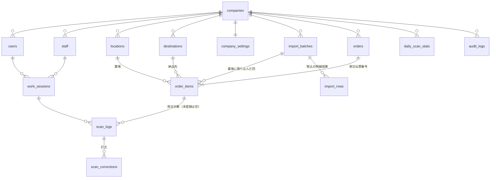

# PARTS GATE データベース設計（D1）

- 版: 0.1（STEP 3 設計・ドラフト）／作成日: 2026-11-05
- 前提: [requirements.md](requirements.md)、[architecture.md](architecture.md)

## 1. 方針

- **会社の業務データを持つ表には、すべて `company_id` を持たせる**。会社をまたぐ参照は外部キー＋同じ `company_id` の複合キーで防ぐ
- 主キーは `INTEGER PRIMARY KEY`（SQLite の rowid）。UUID は 36 バイトで、36 万行×索引数の容量を食うため使わない。番号が推測されても、すべての検索を `company_id` で絞るので他社のデータは見えない（[security.md](security.md) §2）
- 日時は UTC の ISO 文字列（`2026-11-05T01:23:45.678Z`）。業務日（SSD・VRD・集計日）は日本時間の `YYYY-MM-DD`
- **読み取り履歴（scan_logs）と監査ログは上書き・削除しない**。DB トリガーでも拒否する。訂正は `scan_corrections` に追記する
- 注文と読み取り履歴は別の表。CSV を取り込み直しても読み取り履歴は消えない
- 物理削除はしない。マスターは `status = 'inactive'`（利用停止）
- 楽観ロック用に、編集できる表は `version` を持つ

## 2. ER 図

## 3. テーブル定義

### companies（PARTS GATE を使う会社）

| 列 | 型 | 説明 |
| --- | --- | --- |
| id | INTEGER PK | **Space.app の company_id をそのまま使う** |
| name | TEXT NOT NULL | 会社名（初回は `/auth/me` の company_name） |
| code | TEXT NOT NULL UNIQUE | 企業コード（初回は company_slug） |
| address / phone | TEXT | 住所・電話番号 |
| admin_note | TEXT | 管理者情報（担当者名など） |
| status | TEXT NOT NULL | `active` / `suspended` |
| created_at / updated_at / version | | |

### users（PARTS GATE の利用者。アカウント本体は Space.app）

| 列 | 型 | 説明 |
| --- | --- | --- |
| id | INTEGER PK | |
| company_id | INTEGER NOT NULL FK | |
| hs_user_id | INTEGER NOT NULL UNIQUE | Space.app のユーザー ID |
| name / email | TEXT | Space.app から毎回更新 |
| role | TEXT NOT NULL | `admin` / `general` |
| status | TEXT NOT NULL | `active` / `suspended` |
| last_seen_at | TEXT | 最終利用日時（指示書の「最終ログイン日時」） |
| created_at / updated_at / version | | |

### staff（作業担当者。ログインアカウントとは別）

| 列 | 型 | 説明 |
| --- | --- | --- |
| id | INTEGER PK | |
| company_id | INTEGER NOT NULL FK | |
| code | TEXT NOT NULL | 担当者コード。**UNIQUE(company_id, code)** |
| name / department / factory | TEXT | 氏名・所属部署・所属工場 |
| sort_order | INTEGER | 選択画面の並び順 |
| status | TEXT NOT NULL | `active` / `inactive` |
| created_at / updated_at / version | | |

氏名を変えても過去の履歴が分かるように、scan_logs には読み取り時点の氏名（`staff_name`）も保存する。

### locations（置場マスター）

| 列 | 型 | 説明 |
| --- | --- | --- |
| id | INTEGER PK | |
| company_id | INTEGER NOT NULL FK | |
| code | TEXT NOT NULL | 置場コード（CSV と同じ書き方。ヒラノは 4 桁）。**UNIQUE(company_id, code)** |
| name / description | TEXT | |
| status | TEXT NOT NULL | `active` / `inactive` |
| created_at / updated_at / version | | |

### destinations（納品先マスター）

| 列 | 型 | 説明 |
| --- | --- | --- |
| id | INTEGER PK | |
| company_id | INTEGER NOT NULL FK | |
| customer_code | TEXT NOT NULL | 得意先コード |
| code | TEXT NOT NULL | 直送先コード。**UNIQUE(company_id, customer_code, code)**（直送先コードは得意先をまたいで重複するため） |
| name / postal_code / address / phone / note | TEXT | |
| status | TEXT NOT NULL | `active` / `inactive` |
| created_at / updated_at / version | | |

### company_settings（会社ごとの設定。1 社 1 行）

| 列 | 型 | 説明 |
| --- | --- | --- |
| company_id | INTEGER PK FK | |
| match_field | TEXT NOT NULL | 照合に使う列: `barcode_global_no`（既定）/ `global_no` |
| barcode_strip_prefix / barcode_strip_suffix | TEXT | 読み取り値から外す前後の文字（Q-1 の結果で設定） |
| scans_per_item | TEXT NOT NULL | `one`（1 行 1 枚。既定）/ `quantity`（数量分） |
| warn_ship_date_mismatch | INTEGER NOT NULL | 出荷日が今日でない明細を「要確認」にするか（Q-6） |
| csv_profile_json | TEXT NOT NULL | CSV の列名と項目の対応表（[csv-import.md](csv-import.md) §3）。他社の CSV はここを変えて対応 |
| updated_at / version | | |

### import_batches（CSV 取込の回）

| 列 | 型 | 説明 |
| --- | --- | --- |
| id | INTEGER PK | |
| company_id | INTEGER NOT NULL FK | |
| file_name | TEXT NOT NULL | 元のファイル名 |
| file_sha256 | TEXT NOT NULL | 同じファイルの二重取込の検出用。UNIQUE ではない（取り込み直しを許すため。画面で警告） |
| r2_key | TEXT NOT NULL | 元ファイルの保存先 `imports/<company_id>/<yyyy>/<id>.csv` |
| encoding | TEXT NOT NULL | `shift_jis` / `utf-8` |
| status | TEXT NOT NULL | `uploading` / `committed` / `aborted` |
| row_total / row_new / row_updated / row_unchanged / row_error / row_review | INTEGER | 件数 |
| created_by | INTEGER NOT NULL FK users | 取込担当者 |
| created_at / committed_at | TEXT | |

### import_rows（取込の行ごとの結果。エラー・要確認・更新の中身）

| 列 | 型 | 説明 |
| --- | --- | --- |
| id | INTEGER PK | |
| company_id / batch_id | INTEGER NOT NULL | |
| line_no | INTEGER NOT NULL | CSV の行番号 |
| global_no | TEXT | |
| kind | TEXT NOT NULL | `new` / `updated` / `unchanged` / `error` / `review`。「変更なし」も保存する（確定時に件数をここから数え直し、再送で二重に数えないため。migrations/0002） |
| message | TEXT | 理由（例: 置場 0057 が未登録） |
| diff_json | TEXT | 更新時の変更前後 |

### orders（受注伝票）

| 列 | 型 | 説明 |
| --- | --- | --- |
| id | INTEGER PK | |
| company_id | INTEGER NOT NULL FK | |
| slip_no | TEXT NOT NULL | 受注伝票番号。**UNIQUE(company_id, slip_no)** |
| customer_code / customer_name | TEXT | 得意先 |
| item_count / matched_count | INTEGER NOT NULL | 明細数・照合済み数（伝票の進み具合の表示用） |
| created_at / updated_at | TEXT | |

### order_items（注文明細。CSV の 1 行）

| 列 | 型 | 説明 |
| --- | --- | --- |
| id | INTEGER PK | |
| company_id | INTEGER NOT NULL | |
| order_id | INTEGER NOT NULL | FK (company_id, order_id) → orders |
| global_no | TEXT NOT NULL | グローバル番号。**UNIQUE(company_id, global_no)**（再取込の重複防止） |
| barcode_global_no | TEXT NOT NULL | バーコード用グローバル番号。**UNIQUE(company_id, barcode_global_no)** |
| product_code / product_name | TEXT NOT NULL | 商品コード・商品名称（英語） |
| quantity | INTEGER NOT NULL | 数量 |
| required_scans | INTEGER NOT NULL | 照合に必要な読み取り回数（`one` なら 1、`quantity` なら数量） |
| customer_code / customer_name | TEXT | 得意先（検索用に明細にも持つ） |
| destination_id | INTEGER | FK destinations（未登録なら NULL） |
| destination_code / destination_name | TEXT | CSV の直送先コード・直送先名（原文） |
| customer_order_no | TEXT | 顧客注文番号（空欄あり） |
| location_id | INTEGER | FK locations |
| location_code | TEXT NOT NULL | CSV の置場（原文） |
| ssd / vrd | TEXT | メーカー出荷日・ミスミ納期（`YYYY-MM-DD`） |
| order_date | TEXT | 発注日 |
| ship_method | TEXT | 出荷方法 |
| export_type | TEXT | 輸出区分（D / E） |
| unit_weight / total_weight | REAL | 個別重量・商品重量（g） |
| packing_line | TEXT | 梱包ライン No. |
| data_kind | TEXT | データ区分（F） |
| row_hash | TEXT NOT NULL | 取込対象の列から作るハッシュ。「変更なし」の判定に使う |
| status | TEXT NOT NULL | `pending`（照合待ち）/ `matched`（照合済み）/ `review`（要確認）/ `cancelled`（取消）。出荷完了用に `shipped` を予約 |
| scan_count | INTEGER NOT NULL DEFAULT 0 | 正常に数えた読み取り回数 |
| matched_at / matched_staff_id | | 照合完了の日時・担当者 |
| last_import_id | INTEGER NOT NULL | 最後に登録・更新した取込回 |
| created_at / updated_at | TEXT | |

`CHECK (scan_count <= required_scans)` を付け、同時読み取りでも必要回数を超えて数えないことを DB でも保証する。

### work_sessions（作業セッション: ログインした PC で担当者を選んだ状態）

| 列 | 型 | 説明 |
| --- | --- | --- |
| id | INTEGER PK | |
| company_id / user_id / staff_id | INTEGER NOT NULL | |
| staff_name | TEXT NOT NULL | 選んだ時点の氏名 |
| device_id | TEXT NOT NULL | 端末の識別子（ブラウザで生成。localStorage） |
| device_label / user_agent | TEXT | PC 名（任意設定）・ブラウザ情報 |
| started_at / ended_at | TEXT | 担当者変更・ログアウトで `ended_at` を入れる |

### scan_logs（読み取り履歴。追記のみ）

| 列 | 型 | 説明 |
| --- | --- | --- |
| id | INTEGER PK | 読み取り ID |
| company_id | INTEGER NOT NULL | |
| client_scan_id | TEXT NOT NULL | 画面が読み取りごとに作る ID。**UNIQUE(company_id, client_scan_id)**（通信の再送で二重記録しない） |
| work_session_id / user_id / staff_id | INTEGER NOT NULL | |
| staff_name | TEXT NOT NULL | 読み取り時点の担当者名 |
| raw_value | TEXT NOT NULL | リーダーから来た値（そのまま） |
| barcode | TEXT NOT NULL | 整形後の値 |
| order_item_id | INTEGER | 照合対象（未登録なら NULL） |
| result | TEXT NOT NULL | `ok` / `not_found` / `duplicate` / `over_quantity` / `review` / `error` |
| reason | TEXT | 要確認・エラーの理由 |
| location_id | INTEGER | 集計用（明細の置場の写し） |
| scanned_at | TEXT NOT NULL | サーバーが記録した日時（UTC） |
| client_scanned_at | TEXT | 画面で読んだ日時（通信遅延の調査用） |
| day | TEXT NOT NULL | 日本時間の業務日（集計・検索用） |
| device_id | TEXT NOT NULL | |

### scan_corrections（読み取り履歴の訂正。追記のみ）

| 列 | 型 | 説明 |
| --- | --- | --- |
| id | INTEGER PK | |
| company_id / scan_log_id / user_id | INTEGER NOT NULL | |
| action | TEXT NOT NULL | `void`（この読み取りを取り消す）など |
| reason | TEXT NOT NULL | 理由（必須） |
| created_at | TEXT NOT NULL | |

取り消した読み取りが正常だった場合は、scan_corrections への INSERT に付けたトリガーで明細の `scan_count` を戻し、状態を `pending` に戻す。

### daily_scan_stats（集計表。ダッシュボード用）

| 列 | 型 | 説明 |
| --- | --- | --- |
| company_id / day / staff_id / location_id / result | | **PRIMARY KEY(company_id, day, staff_id, location_id, result)**（置場不明は 0） |
| count | INTEGER NOT NULL | |

scan_logs への INSERT に付けたトリガーで `INSERT … ON CONFLICT DO UPDATE SET count = count + 1` する（[scan-matching.md](scan-matching.md) §5）。画面を開くたびに scan_logs を数えないので、読み取り行数（無料枠）をほとんど使わない。

### audit_logs（監査ログ。追記のみ）

| 列 | 型 | 説明 |
| --- | --- | --- |
| id | INTEGER PK | |
| company_id | INTEGER NOT NULL | |
| user_id / hs_user_id | INTEGER | |
| action | TEXT NOT NULL | 例: `import.commit`、`location.update`、`scan.void`、`user.role_change`、`settings.update` |
| target_type / target_id | TEXT | |
| detail_json | TEXT | 変更前後など |
| ip / user_agent | TEXT | |
| created_at | TEXT NOT NULL | |

### backup_runs（バックアップの記録）

| 列 | 型 | 説明 |
| --- | --- | --- |
| id | INTEGER PK | |
| kind | TEXT NOT NULL | `daily_incremental` / `manual_full` |
| from_at / to_at | TEXT | 対象期間 |
| r2_prefix | TEXT | 保存先 |
| row_counts_json / status / error | TEXT | |
| created_at | TEXT | |

## 4. 索引（検索条件ごと）

| 用途 | 索引 |
| --- | --- |
| 照合（最重要） | UNIQUE `order_items(company_id, barcode_global_no)`、UNIQUE `order_items(company_id, global_no)` |
| 注文一覧（出荷日・状態） | `order_items(company_id, ssd, status)` |
| 未確認一覧 | `order_items(company_id, status, ssd)` |
| 商品コード検索（前方一致） | `order_items(company_id, product_code)` |
| 得意先・納品先・置場 | `order_items(company_id, customer_code, ssd)`、`order_items(company_id, destination_id, ssd)`、`order_items(company_id, location_id, ssd)` |
| 伝票 | `order_items(company_id, order_id)` |
| 読み取り履歴（日付・担当者・結果） | `scan_logs(company_id, day, id)`、`scan_logs(company_id, staff_id, day)`、`scan_logs(company_id, result, day)` |
| 明細ごとの履歴 | `scan_logs(company_id, order_item_id)` |
| バーコード検索 | `scan_logs(company_id, barcode)` |
| 再送の重複防止 | UNIQUE `scan_logs(company_id, client_scan_id)` |
| 監査ログ | `audit_logs(company_id, created_at)` |

- 一覧はキーセット方式のページ送り（`(ssd, id)` や `(day, id)` の続きから `LIMIT 50`）。`OFFSET` は使わない（後ろのページほど読む行が増える）
- 商品名・得意先名などの**部分一致検索は期間（最長 3 か月）の指定を必須**にし、索引で期間を絞ってから探す
- 新しい SQL を足したら `EXPLAIN QUERY PLAN` で全件走査（SCAN）がないことをテストで確認する（TENQ の `api/test/schema.test.ts` と同じ方法）

## 5. 書き換え・削除を拒否するトリガー

- `scan_logs`・`scan_corrections`・`audit_logs`: UPDATE / DELETE を拒否
- `order_items`・`orders`・マスター: DELETE を拒否（利用停止・取消で対応）
- `import_batches`: `committed` になった後の UPDATE を拒否
- 数え上げのトリガー: `scan_logs` の INSERT で明細の `scan_count`・伝票の `matched_count`・`daily_scan_stats` を更新（[scan-matching.md](scan-matching.md) §5）
