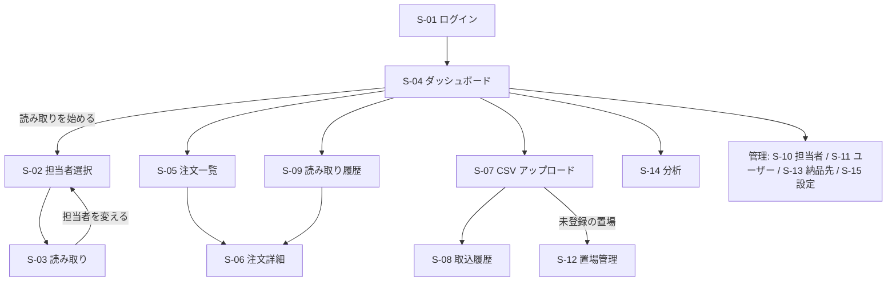

# PARTS GATE 画面構成

- 版: 0.1（STEP 3 設計・ドラフト）／作成日: 2026-11-05
- 見た目は STEP 4 の前にモック（`_mock-*.html`）で確認する

## 1. 画面一覧

| ID | 画面 | パス | 権限 | 主な端末 |
| --- | --- | --- | --- | --- |
| S-01 | ログイン（2 段階認証を含む） | `#/login` | — | PC・スマホ |
| S-02 | 担当者選択 | `#/staff-select` | 一般 | PC |
| S-03 | **バーコード読み取り** | `#/scan` | 一般 | PC（最優先） |
| S-04 | ダッシュボード | `#/` | 一般 | PC・スマホ |
| S-05 | 注文データ一覧 | `#/orders` | 一般 | PC・スマホ |
| S-06 | 注文データ詳細 | `#/orders/:id` | 一般 | PC・スマホ |
| S-07 | CSV アップロード（プレビュー・確定） | `#/imports/new` | 管理 | PC |
| S-08 | CSV 取込履歴 | `#/imports` | 管理 | PC |
| S-09 | 読み取り履歴 | `#/scan-logs` | 一般 | PC・スマホ |
| S-10 | 担当者管理 | `#/staff` | 管理 | PC |
| S-11 | ユーザー管理 | `#/users` | 管理 | PC |
| S-12 | 置場管理 | `#/locations` | 管理 | PC |
| S-13 | 納品先管理 | `#/destinations` | 管理 | PC |
| S-14 | データ分析 | `#/analytics` | 管理 | PC・スマホ |
| S-15 | システム設定（照合ルール・CSV 列の対応・監査ログ） | `#/settings` | 管理 | PC |
| S-16 | 企業管理 | `#/admin/companies` | 運営 | PC |

## 2. 画面のつながり



左メニュー: ダッシュボード・読み取り・注文・読み取り履歴・（管理者）CSV 取込・分析・マスター・設定。下部は Space.app 共通の「利用者名とロール → アプリ選択に戻る」（スキル `space-app-shell`）。

## 3. 読み取り画面（S-03）の配置

```
┌──────────────────────────────────────────────────────────────┐
│ PARTS GATE   担当: 山田 太郎（出荷場PC1）      [担当者を変える] │
├──────────────────────────────────────────────────────────────┤
│ ┌──────────────── 結果の帯（緑／黄／赤）────────────────────┐ │
│ │ ✔ 正常                                    10:23:45       │ │
│ │ 5P000000000001                                           │ │
│ └──────────────────────────────────────────────────────────┘ │
│  商品コード  MVSHM-XXXXXXX-XXX-XXXXX         数量   1         │
│  商品名      MEVIY SHEET METAL                置場  0053 東日本│
│  得意先      サンプル工業（株）               納期  11/05      │
│  お届け先    サンプル工業（株）第1工場        伝票  3 / 9 済   │
│                                                              │
│  [ バーコードを読み取ってください ▌            ] 確認中…      │
├──────────────────────────────────────────────────────────────┤
│ 今日  読み取り 128   正常 121   重複 5   エラー 2             │
│ 直近: ✔10:23 …276  ✔10:22 …275  ⚠10:21 …270 読み取り済み …   │
└──────────────────────────────────────────────────────────────┘
```

- 文字は大きく（結果 40px 以上、項目 20px 以上）。マウスを使わずに続けて読める
- 結果の帯は色・アイコン・文字の 3 つで表す
- 入力欄は常にフォーカス。担当者変更中・ログイン切れのときは入力欄を無効にし、理由を表示

## 4. デザイン方針

- 白とダークグレーを基本に、正常＝緑・警告＝黄・異常＝赤だけを強い色として使う
- 装飾を減らし、文字を大きく、行間を広く。PC 操作を最優先し、スマホは閲覧中心（一覧はカード表示に切り替え）
- 入力欄のフォントは 16px 以上（iOS の自動ズーム対策）、押す場所は 44px 以上
- 文言は日本語。画面の文字は `web/src/labels.ts` に集め、将来の多言語化に備える
